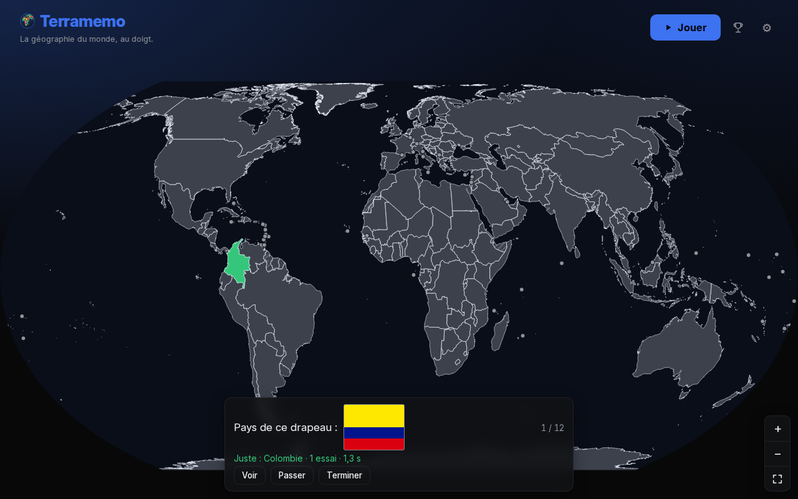
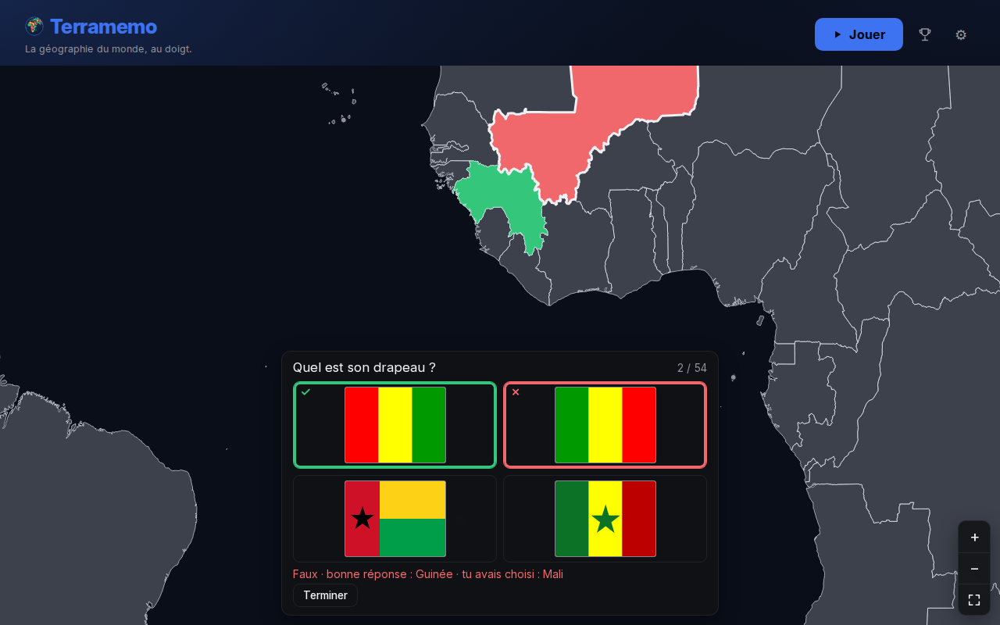
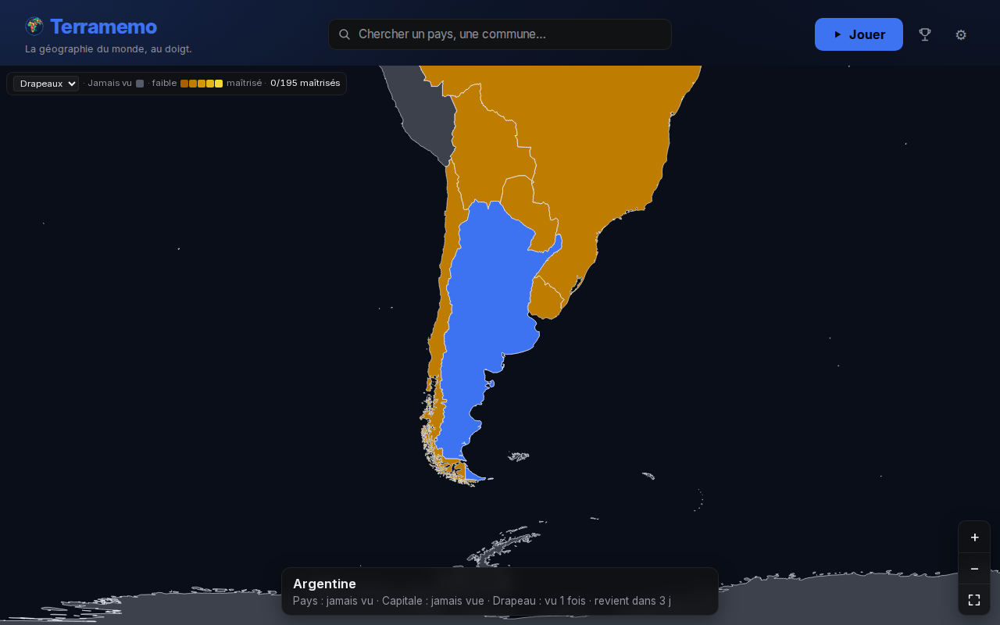

# Terramemo

Un site et une appli Android pour devenir bon en géographie : placer chaque
pays sur la carte, connaître capitales et drapeaux, puis le relief, les
fleuves et les ordres de grandeur. Gratuit, sans publicité, en français
(prêt à traduire).

**Site en ligne : [terramemo-geo.web.app](https://terramemo-geo.web.app)** —
l'appli Android n'est pas encore sur le Play Store ; une version d'essai
(APK de débogage, à installer à la main) est dans les
[Releases](https://github.com/MichelDM974/Terramemo/releases) du dépôt.

> **In English** — Terramemo is a free geography trainer (website and Android app)
> built on spaced repetition on the map: a world map coloured by how well you remember
> each place. TypeScript and Vite, Canvas 2D / WebGL map, FSRS scheduling, Capacitor
> for Android, Firebase for accounts, sync and leaderboards.

[](https://github.com/MichelDM974/Terramemo/actions/workflows/ci.yml)



## Le concept

Terramemo n'est pas un quiz qu'on enchaîne, mais un entraînement par
**répétition espacée sur la carte** : chaque fait (« où est le Pérou ? »,
« quel est ce pays ? ») revient au moment où l'on est sur le point de
l'oublier, jusqu'à tenir des mois.

<p>
  
  
</p>

- L'accueil est une **carte du monde colorée selon la solidité de sa
  mémoire** : on voit ses lacunes là où elles sont.
- Chaque erreur se montre **sur la carte** : là où l'on a touché, là où
  était la réponse, et la distance entre les deux.
- Les mauvais choix proposés viennent de **ses propres confusions** (Niger
  et Nigeria, Slovénie et Slovaquie), et les nouveautés arrivent par petits
  groupes de voisins.
- Des **épreuves chronométrées** (tous les pays d'un continent, score en
  pourcentage de justes, départagé par le temps) et un classement de tous
  les joueurs ; les séances de révision, courtes, s'arrêtent quand on veut.
- Deux exercices pour chaque série : **Trouver** (toucher la zone nommée)
  et **Reconnaître** (la zone s'allume, choisir son nom parmi quatre, ses
  voisines en leurres).
- En haut, une **recherche** (un pays, un territoire, une commune de La
  Réunion : la carte vole jusqu'à lui) et le bouton **Jouer**, qui ouvre
  un arbre de gros boutons, un choix par écran : le **Quiz général**,
  **Entraînement** ou **Classé**, puis le sujet (Pays, Capitales,
  Drapeaux, Océans et mers, Communes), la série (tous les pays, un
  continent ; La Réunion), et l'exercice en dernier, qui lance la partie :
  en entraînement Trouver et Reconnaître, en épreuves classées **Chrono**
  (toute la série) et **Sans faute** (jusqu'à la première erreur), 15 s
  par question, chaque réponse juste ou fausse : le score est la part de
  justes (« 190/195 · 97 % »), le temps départage ; chacune avec son
  record dans la série et ses classements ; le 🏆 les montre toutes.
  **Rejouer**, au bilan de chaque partie, relance la même d'une touche.
- Le **Quiz général** : 20 questions tirées à parts égales dans tous les
  sujets (pays, capitales, drapeaux, océans et mers), en quatre
  difficultés, de Facile (lieux très connus, 20 questions à 4 choix) à
  Expert (tous les lieux, voisins et sosies en leurres, 12 questions sur
  la carte, 6 et 10 s) ; le score est la part de justes (« 17/20 ·
  85 % »), un classement par difficulté, hors du général. La partie
  compte dès sa première question : abandonnée, elle garde le score
  acquis, même si la page se ferme ou l'appli est tuée en pleine partie
  (elle compte au démarrage suivant).
- Sur ordinateur, des boutons **+**, **−** et « toute la carte » en bas à
  droite (et les touches + et −) pour zoomer sans molette.
- Dans ⚙, des **lignes de repère** à cocher : l'équateur, le méridien de
  Greenwich, les tropiques, les cercles polaires et une grille de 30°,
  nommées sur la carte, à l'accueil comme pendant les parties.
- **La Réunion** : ses 24 communes sur une carte de l'île, en série de
  Toucher et des épreuves classées (avec leurs classements).

## Approche technique

- Une seule base de code web (TypeScript, Vite) pour le site et l'appli
  Android, emballée en APK par Capacitor ; carte du monde qui tourne comme
  un globe, dessinée en Canvas 2D (d3-geo pour les données ; WebGL et SVG
  au choix dans ⚙), hors ligne : l'APK embarque ses fichiers, le site les
  garde après une première visite (service worker, sur le web seulement,
  un cache par version : `src/sw/`).
- Planification des révisions par FSRS (bibliothèque `ts-fsrs`).
- Progrès en journal de réponses, en ajout seul, sur l'appareil
  (IndexedDB). On joue sans compte ; un compte Google ou e-mail et mot de
  passe (Firebase Auth, ouvert à tous sur le site depuis le 11/11/2026)
  envoie ses séances à Firestore par lots et retrouve ses progrès sur un
  autre appareil ; dans l'appli Android, la connexion avec Google est
  encore en essai. Le compte anonyme ne sert qu'à publier ses scores au
  classement ; les règles Firestore (classements, comptes) sont testées
  sur l'émulateur.
- Données libres préparées par un script reproductible : frontières de
  Natural Earth (domaine public), noms du référentiel Unicode CLDR,
  capitales et populations de Wikidata (CC0), drapeaux de flag-icons (MIT).

Le détail des études préparatoires est dans [`docs/etudes/`](docs/etudes/)
et le plan arrêté dans [`docs/plan.md`](docs/plan.md) ; J0, J1a, J1b… y
désignent les jalons du plan.

## Structure du dépôt

```
src/
  map/        carte du monde : projection, rendus Canvas 2D, WebGL et SVG, gestes, zoom
  srs/        répétition espacée (FSRS), séances, planification
  journal/    journal des réponses sur l'appareil (IndexedDB)
  quiz/       génération des questions du quiz général
  epreuve/    épreuves chronométrées, barème, classements
  sync/       comptes Firebase, envoi des séances, suppression du compte
  vues/       écrans de l'appli (accueil, Jouer, compte, crédits…)
  sw/         service worker du site (hors ligne)
  mesure/     instrumentation des gestes, pour les relevés de docs/mesures
geodata/      script reproductible des données de la carte (sources épinglées)
public/geo/   données générées servies au navigateur
android/      projet Capacitor de l'appli Android
licences/     relevé et textes des licences tierces
tests/        tests Vitest, règles Firestore sur l'émulateur
docs/         plan, études préparatoires, relevés de mesure
.claude/skills/run-terramemo/   outillage de l'assistant de code (voir « Méthode »)
```

## Développement

Prérequis : Node 24 (`.nvmrc`) ; pour l'APK, le SDK Android et un JDK 21.

```bash
npm ci               # dépendances, versions figées (package-lock.json)
npm run dev          # site en développement sur http://localhost:8060
npm test             # tests (Vitest), aussi lancés par la CI à chaque push
npm run test:regles  # règles Firestore sur l'émulateur (JDK 21), aussi en CI
npm run typecheck    # vérification des types (TypeScript)
npm run build        # site statique dans dist/ (servi par Firebase Hosting)
```

- **Déploiement** (projet Firebase `terramemo-geo`) : depuis le PC, juste
  après le commit, sur un arbre propre, `npm run build` puis
  `npx firebase deploy --only hosting` ; `--only firestore` après un
  changement de `firestore.rules` ou des index. La vérification sur le
  site en ligne et le reste de la procédure sont dans le skill
  `run-terramemo` (`.claude/skills/run-terramemo/SKILL.md`).

- **Données de la carte** : `npm run geodata` télécharge les sources
  épinglées (version et empreinte dans `geodata/sources.lock.json`) et
  régénère `public/geo/` ; deux lancements donnent des fichiers identiques
  octet pour octet. La liste des pays (193 membres de l'ONU, Vatican,
  Palestine, et un paquet optionnel) est dans `geodata/liste.json`.
- **Extraits de Wikidata** (capitales, notoriété du quiz) : figés dans
  `geodata/wikidata/`, rafraîchis à la main par `npm run wikidata` (les
  capitales) et `npm run wikidata -- --notoriete` (les vues sur 12 mois des
  articles des pays, ~17 min), puis `npm run geodata -- --seulement
  capitales` ou `notoriete` ; le build ne requête jamais. Les niveaux du
  quiz se corrigent à la main dans `geodata/notoriete-main.json`.
- **Communes de La Réunion** : `npm run geodata:reunion` régénère
  `public/geo/reunion/` depuis l'archive de l'IGN (empreinte dans
  `geodata/reunion.lock.json`, archive gardée dans `geodata/raw/ign/`).
- **APK de débogage** : `npm run build && npx cap sync android`, puis
  `./gradlew assembleDebug` dans `android/` avec `JAVA_HOME` sur un JDK 21 ;
  la CI le construit aussi à la demande (workflow « Android »).
- **Crédits** : frontières Natural Earth (domaine public), noms Unicode
  CLDR (Unicode License v3), police Inter (SIL OFL 1.1), communes de La
  Réunion : IGN, ADMIN EXPRESS COG CARTO (Licence Ouverte 2.0 d'Etalab :
  source et date de mise à jour affichées sur la carte de l'île) ; le
  détail des sources est dans `public/geo/sources.json` et
  `public/geo/reunion/sources.json`. L'écran Crédits de l'appli (⚙ ›
  Crédits et licences) les reprend, avec les bibliothèques que le site
  et l'APK embarquent et leurs licences (MIT, ISC, BSD-3-Clause,
  Apache-2.0, 0BSD ; dans l'APK seulement, les services Google Play de la
  connexion avec Google, sous la licence du SDK Android, non libre), dont
  il déplie les textes et avis de copyright :
  `licences-tierces.txt`, produit à chaque build (`licences/tierces.ts`).
  Les bibliothèques Android y viennent de `licences/android.json`, relevé
  par Gradle : `npm run licences:android` (JDK 21) après une mise à jour de
  Capacitor ou d'AndroidX, que la CI Android et `driver.py apk` vérifient.
  Les avis de tiers des AAR de Google (`third_party_licenses.txt` : le
  code libre qu'ils embarquent) viennent de `licences/android-avis.json`,
  relevé par le même script dans le cache de Gradle (`--avis` : sans
  Gradle, d'après `android.json`, une fois l'APK construit).

## Méthode

Ce projet est développé avec Claude Code, l'assistant de programmation d'Anthropic :
il écrit l'essentiel du code, d'où la mention « Co-Authored-By: Claude » des commits.
Mon travail : définir ce que fait l'appli et pour qui, trancher les choix de
conception (les études de [`docs/etudes/`](docs/etudes/) les préparent, avant toute
ligne de code), fixer les critères qui valident un changement, et essayer le résultat
en conditions réelles, au doigt sur un téléphone Android comme sur le site. Le dossier
`.claude/skills/run-terramemo/` est l'outillage qui permet à l'assistant de lancer le
site, de le piloter, de le photographier et d'en mesurer la fluidité lui-même avant de
rendre son travail ; certains de ses outils sont eux-mêmes testés en CI. Les numéros #N des messages
de commit renvoient à mon suivi de tickets personnel, qui n'est pas public.

## Licence et crédits

Code consultable, tous droits réservés © 2026 Michel Delhomme. Les données et les
bibliothèques embarquées gardent leurs propres licences, détaillées ci-dessus
(« Crédits »), dans le dossier [`licences/`](licences/) et dans l'écran Crédits de
l'appli.
